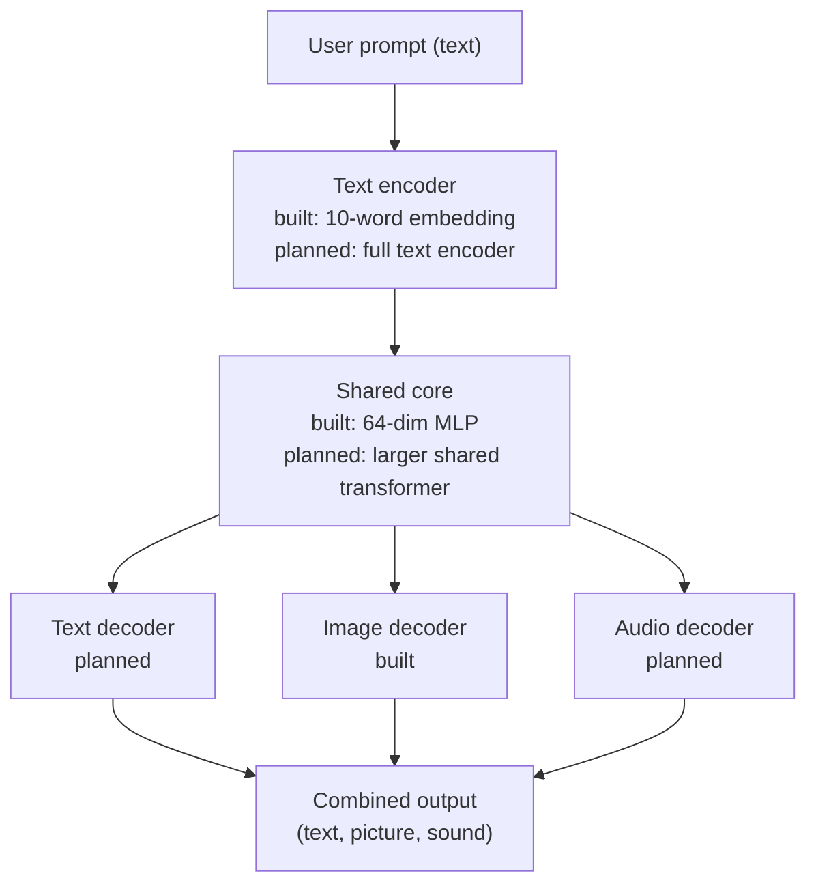
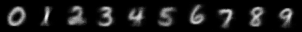

# Shared-Representation Digit Model

A small multimodal project inspired by MiniMax H3. One model maps digit images and digit words into a single shared vector space, then recognizes and generates across both.

## What it does

The model has two input paths, one for images and one for words, which feed into the same shared core. From that shared representation it can:

- **Recognize images:** classify a handwritten digit (0 to 9) from MNIST.
- **Recognize words:** map the words "zero" to "nine" to their digit.
- **Generate images from words:** turn a word into a 28x28 digit image, then check whether the image path recognizes it as the same digit.

Training uses five losses at once: image classification, word classification, image reconstruction, word-to-image generation, and an alignment loss that pulls the image and word vectors for the same digit together.

## How it differs from MiniMax H3

MiniMax H3 is a large omni-modal model that handles text, image, and audio in one system, trained on very large datasets with substantial compute. This project is a small proof of the same core idea: one shared representation used by more than one modality. It uses two modalities (images and words), ten classes, a small convolutional encoder, and a short training run on a laptop CPU. It does not attempt to match H3's scale, quality, or range of outputs.

## Architecture

The diagram below shows the planned system. Components marked *built* exist in `main.py`. Components marked *planned* are the next milestones.



**How a prompt flows through the system:**

1. The user provides a prompt.
2. The text encoder turns it into a vector.
3. The shared core processes that vector, whichever output is needed.
4. Each decoder produces its own output from the shared vector.
5. The outputs are returned together.

## Relation to the planned system

| Part | Current model | Planned system |
|---|---|---|
| Input | Digit images and 10 digit words | Free-form text prompts |
| Encoder | Image CNN and word embedding table | Text encoder, plus image and audio encoders |
| Shared core | Small MLP, 64 dimensions | Larger shared transformer |
| Output | Digit classifier and image decoder | Text, image, and audio decoders |
| Data | MNIST (images only) | Paired text, image, and audio data |

**What the current model taught us:**

- A shared space can link two input types. Images and words for the same digit land close together, so the model can go from a word to a picture and back.
- The cycle test (word → image → recognized) is a useful check. A word-generated image is recognized as the right digit 100% of the time, which suggests the two paths share a representation.
- Joint training needs several losses. Recognition, reconstruction, generation, and alignment each pull the shared space in a different direction, so they must be balanced.
- Simple tasks can look better than they are. Word recognition is 1.000 only because it is a lookup over ten fixed inputs. Real prompts will be much harder.

**About MiniMax H3:** this project does not run or reproduce MiniMax H3. It is a small, independent attempt at the same idea: one shared representation serving several output types.

## Results

Trained for 5 epochs with the Adam optimizer on the MNIST training set, evaluated on the MNIST test set:

| Metric | Score |
|---|---|
| Image recognition accuracy (test set) | 0.988 |
| Word recognition accuracy | 1.000 |
| Word → image → recognized accuracy | 1.000 |

Word recognition is near-perfect because the word task is a lookup over ten fixed inputs, so it is easy by design. The word → image → recognized score is the more meaningful result: it shows that images generated from words are recognized by the image path as the correct digit, which means the two paths share a representation.


## Limitations

- Digits only: ten classes, no open vocabulary.
- Two modalities: images and words. Audio and video are not included.
- Generated images are blurry, as expected from a small decoder trained for a few epochs.
- Short training run (5 epochs) on a CPU.
- The word path is a lookup table, so it does not learn language.

## Next steps

- Add audio using the Speech Commands dataset and spectrograms, so the same shared core handles a third modality.
- Expand the vocabulary beyond ten digits, using a larger text dataset.
- Replace the small convolutional decoder with a stronger generator and train for longer.
- Compare the shared model against separate single-modality models to measure whether sharing helps.

   ## How to run

```
   pip install torch torchvision matplotlib
   python main.py
```

The first run downloads MNIST into `data/`. Outputs are saved to `outputs/`: the trained model (`model.pt`) and the generated image grid.